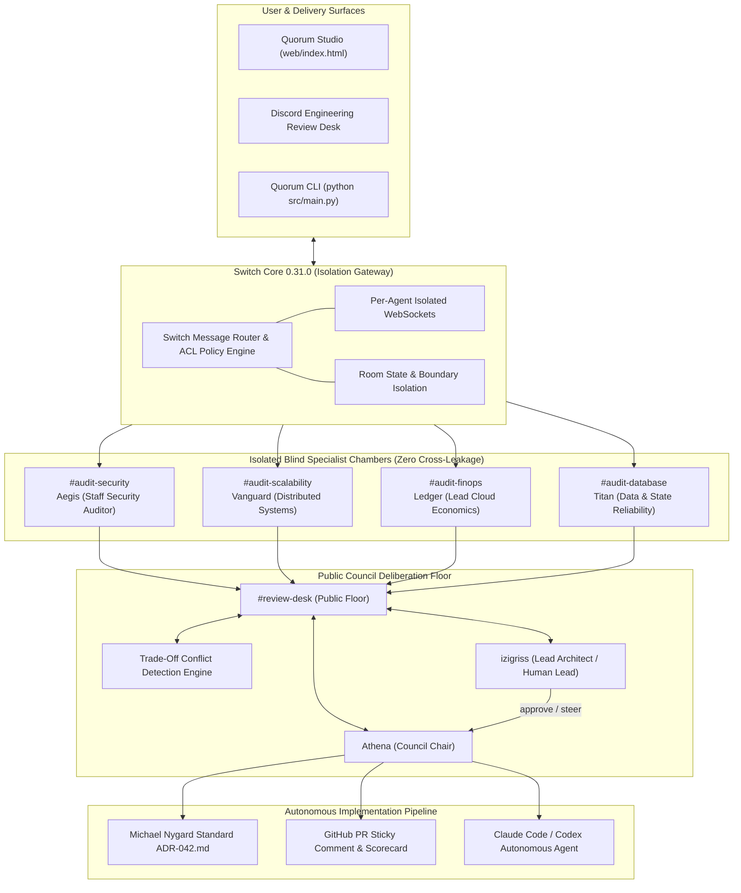

# Quorum 2.0 System Architecture & Technical Specification

**Project:** Quorum — Multi-Agent Blind Architecture Review Desk  
**Hackathon Track:** Track 01: Best Business Workflow ($2,000 Prize)  
**Target Environment:** Switch Core 0.31.0, Discord API / Gateway Webhooks, Terminal Coding Agents (Claude Code / Codex)  
**Specification Version:** 2.0.0 (Production Enterprise Standard)

---

## 1. High-Level Architecture Topology



---

## 2. Key Architectural Invariants

Quorum enforces five core operational invariants (defined formally in [docs/invariants.md](docs/invariants.md)):
1. **INV-SEC-01 (Security Invariant):** Sub-millisecond token revocation verification ($\tau_{\text{revocation}} < 1\text{ms}$) via Redis Bloom filter at ingress edge.
2. **INV-SCALE-02 (Scalability Invariant):** Zero synchronous relational database lookups during 100k connection reconnection bursts ($p99 < 18\text{ms}$).
3. **INV-FIN-03 (FinOps Invariant):** Infrastructure compute right-sizing with autoscaling triggers, saving $25,200 annually.
4. **INV-DATA-04 (Data Invariant):** Transactional Outbox pattern with Debezium CDC for zero lost messages under worker failure.
5. **INV-ISO-05 (Protocol Invariant):** Zero cross-room token leakage ($P(\text{leak}) = 0$) enforced by Switch Core 0.31.0 network ACLs.

---

## 3. Autonomous Implementation Bridge

Upon human approval (`approve`), Quorum generates the Section 6 implementation manifest and triggers autonomous terminal coding agents (Claude Code / Codex):
```bash
claude -p "Read ADR-042.md Section 6. Switch to branch 'feat/adr-042-impl'. Implement the scaffolded files in '.'. Run 'pytest tests/ -v' and do not finish until all tests pass."
```
