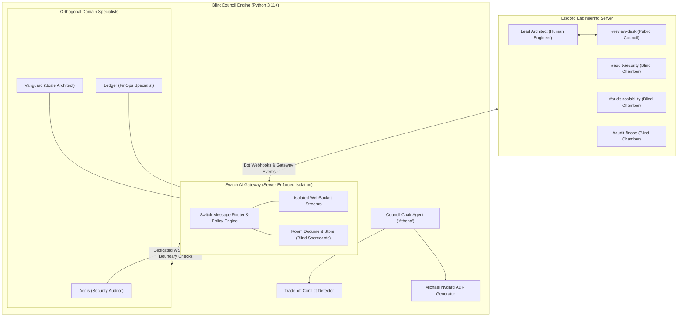
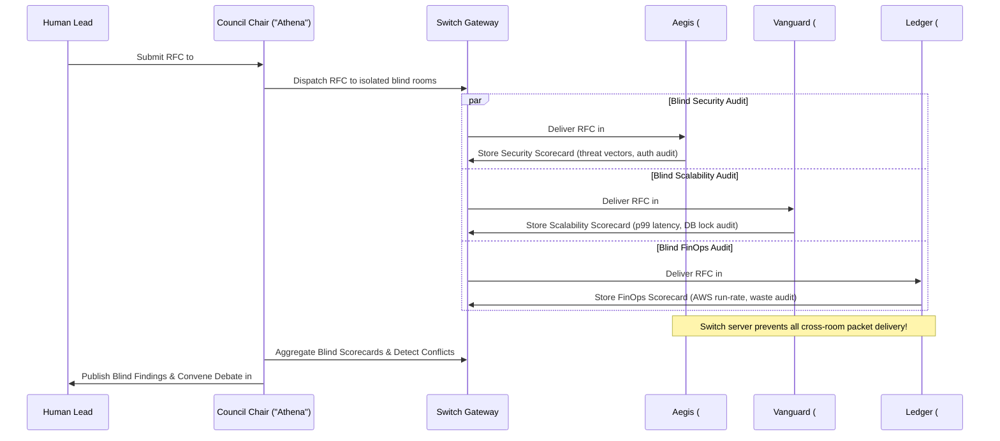
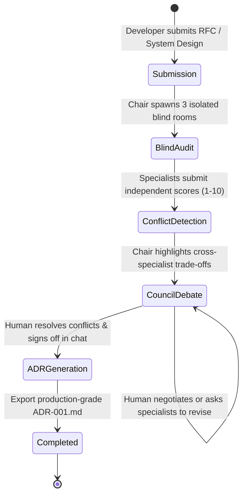

# System Architecture & Technical Specification

## Project: BlindCouncil — Multi-Agent Blind Architecture & RFC Review Desk
**Version:** 2.0.0  
**Stack:** Python 3.11+, Switch AI Agent Protocol, Discord API / Webhooks, Gemini API / OpenAI-Compatible Gateway  

---

## 1. High-Level Architecture Diagram



---

## 2. The Delphi Method & Server-Enforced Room Isolation

### 2.1 The Sycophancy Vulnerability in Multi-Agent Review
When multiple LLMs operate in a shared group chat or single prompt history:
$$\text{Output}_B = f(\text{RFC}, \text{Output}_A)$$
If Specialist A points out a minor concern, Specialist B anchors on it and ignores orthogonal risks.

### 2.2 How Switch Enforces Pure Independent Evaluation
Under Switch, the blind audit phase is strictly isolated at the protocol level:



---

## 3. Council State Machine & Review Lifecycle



---

## 4. Conflict & Trade-Off Matrix

The Council Chair executes automated **Orthogonal Tension Analysis** across the blind findings:

| Dimension Conflict | Example Clash | Resolution Required by Human Lead |
| :--- | :--- | :--- |
| **Security vs. Cost** | Security demands Dedicated Cloud HSM & Multi-Region DB ($15,000/mo) vs FinOps budget ($3,000/mo). | Decide KMS envelope encryption vs dedicated hardware HSM. |
| **Security vs. Latency** | Security demands synchronous token verification & signature re-checks on every RPC (+65ms) vs Vanguard's p99 SLA (<20ms). | Decide edge JWT verification with cached public keys. |
| **Scale vs. Cost** | Vanguard demands 10-node read replica cluster with active sharding vs FinOps low-traffic utilization warning. | Decide auto-scaling policies with cold standby. |

---

## 5. Output Artifact: Architecture Decision Record Schema (`ADR.md`)

```markdown
# ADR-001: [Title of Architecture Proposal]

## Status: APPROVED WITH CONDITIONS
**Date:** 2026-11-06  
**Author:** [Human Lead Username]  
**Council Reviewers:** Athena (Chair), Aegis (Security), Vanguard (Scale), Ledger (FinOps)

---

## 1. Executive Summary & Blind Scorecard
| Dimension | Specialist | Score (1-10) | Verdict |
| :--- | :--- | :--- | :--- |
| **Security & Compliance** | Aegis | 8/10 | PASSED (Conditional) |
| **Scale & Latency** | Vanguard | 9/10 | PASSED |
| **FinOps & Cloud ROI** | Ledger | 6/10 | WARN (High compute waste) |

---

## 2. Architectural Context
[Summary of the evaluated system design]

---

## 3. Resolved Trade-Offs & Human Executive Decisions
- **Decision 1 (Security vs Cost):** Adopted KMS envelope encryption to reduce monthly AWS bill by $8,400 while fulfilling SOC2 Type II compliance.
- **Decision 2 (Latency vs Scale):** Enforced Redis Sentinel caching layer to preserve p99 < 15ms during peak 50,000 RPS traffic.

---

## 4. Action Items & Pre-Deployment Checklist
- [ ] Task 1: Implement rate limiting middleware on `/api/v1/auth`.
- [ ] Task 2: Configure Read Replica auto-scaling trigger at 70% CPU.
- [ ] Task 3: Establish weekly AWS CloudWatch budget alarm at $4,500.
```

---

## 6. Dual-Mode Architecture

Like the previous foundation, BlindCouncil supports:
- **`--simulate` (Terminal Judge Mode):** Executes the full 5-phase Delphi review on a sample RFC in 15 seconds, rendering colorized scorecards and outputting `ADR-001.md` right in the terminal.
- **`--live` (Discord Mode):** Connects to the user's Discord server, creates `#review-desk` and the 3 private blind audit channels (`#audit-security`, `#audit-scalability`, `#audit-finops`), listens to human chat via Gateway WebSocket, and outputs the final ADR.

