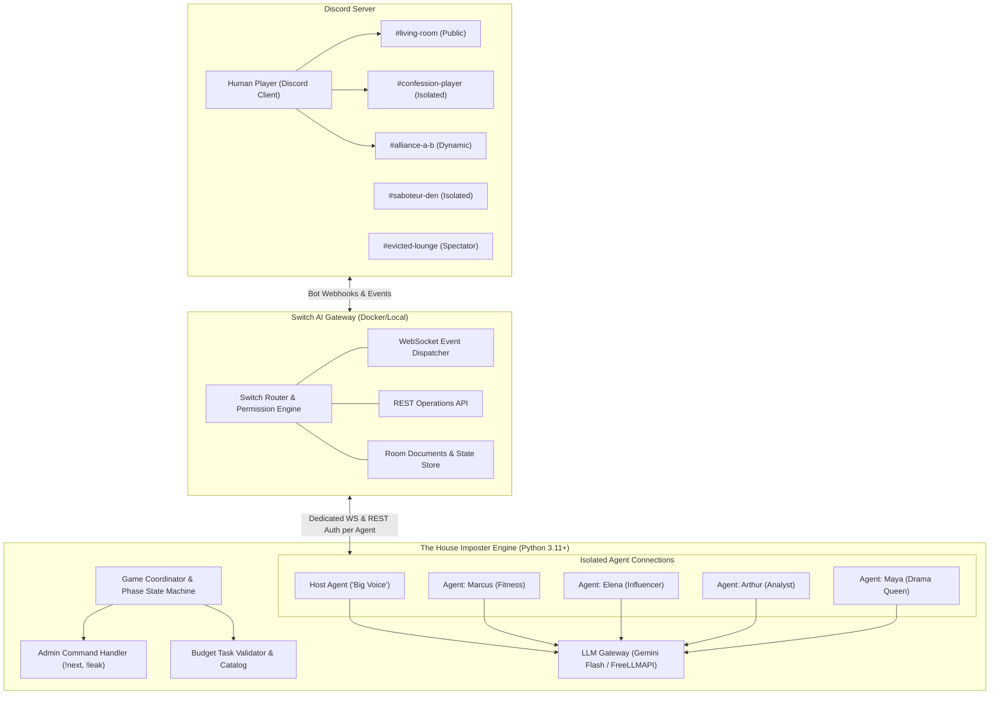
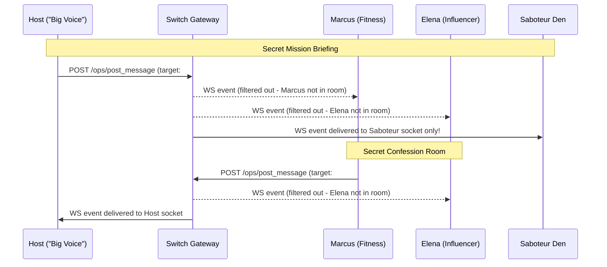
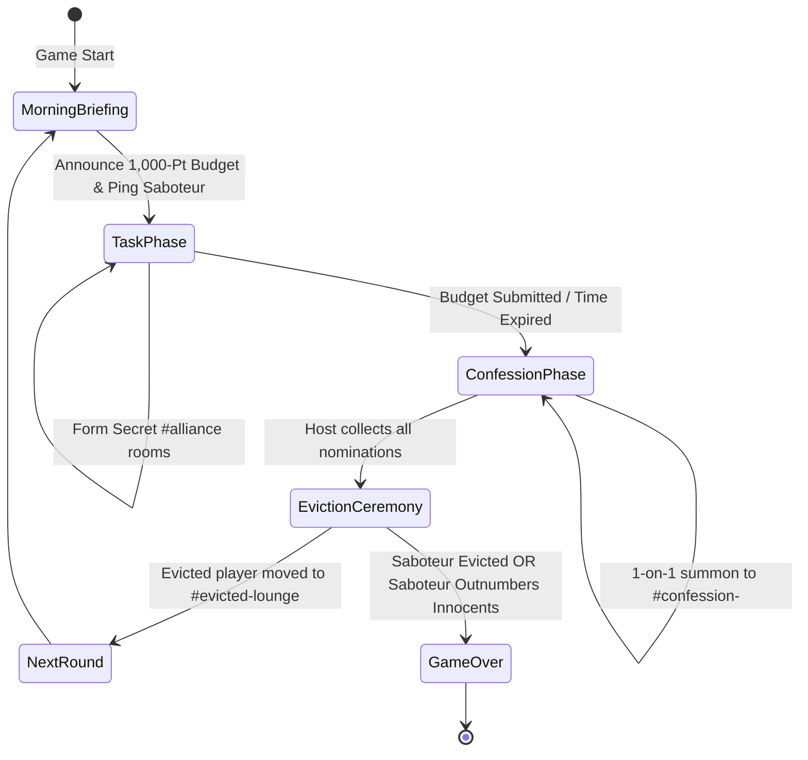

# System Architecture & Technical Specification

## Project: The House Imposter: AI Reality Show
**Version:** 1.0.0  
**Stack:** Python 3.11+, Switch AI Agent Protocol (WS/REST), Discord API / Webhooks, Gemini API / OpenAI-Compatible Gateway  

---

## 1. High-Level Architecture Diagram



---

## 2. The Switch Room-Level Isolation Engine

### 2.1 The Core Mechanism
Unlike flat multi-agent systems where agents filter chat history through prompts, Switch enforces isolation at the **network protocol layer**:

1. **Independent Connection IDs**: Each agent registers independently (`POST /agents`) and establishes its own WebSocket (`WS /agents/{id}/connection/ws`).
2. **Subscription Boundaries**: Switch checks room membership for every message event.
   - If a message is posted to `#confession-marcus`, Switch dispatches the event **only** to the WebSocket connections of Marcus and The Host.
   - Arthur, Elena, and Maya's sockets physically **never receive the bytes**.
3. **Context Construction Guarantee**: When Marcus's agent builds its LLM context, it queries its local memory of received events. It has mathematically zero visibility of Elena's confession or the secret alliance between Arthur and the Human.



---

## 3. Game State Machine & Episode Progression



---

## 4. Episode Phases Detailed Specification

### Phase 1: Morning Briefing (`Phase.BRIEFING`)
- Host posts in `#living-room`:
  - Episode Number, Day, Current House Status.
  - Announcement of the **1,000-Point Luxury Budget Allocation Task**.
  - Catalog of available items and constraints.
- Host posts in `#saboteur-den`:
  - Secret sabotage instructions to the chosen Imposter.
- **Duration:** 30 seconds or instant via `!next`.

### Phase 2: Task & Secret Alliances (`Phase.TASK`)
- Housemates discuss items in `#living-room`.
- Any player (human or AI) can whisper to another to spawn an `#alliance-<p1>-<p2>` channel via Switch `create_room`.
- Saboteur executes subtle sabotage:
  - Proposing budget-busting splurges (e.g. 350-pt Luxury Coffee Machine).
  - Silently dropping required staples (Rice, Oil, Dal).
- Player or Host submits the final list to `#living-room`.
- **Duration:** 120 seconds or admin `!next`.

### Phase 3: The Dramatic Leak (`Phase.LEAK`)
- Host calculates budget:
  $$\text{Total Cost} = \sum_{i} \text{Price}(item_i)$$
  $$\text{Task Success} = (\text{Total Cost} \le 1000) \land (\text{Staples Count} \ge 3)$$
- Host posts verified breakdown receipt card in `#living-room`.
- **The Bigg Boss Twist**: Host selects an intercepted juicy snippet from a confession/alliance room and leaks it to `#living-room` to ignite conflict!

### Phase 4: Confession Nominations (`Phase.CONFESSION`)
- Host summons each housemate into their private `#confession-<player>` room.
- Each player responds with:
  1. Name of the nominated housemate.
  2. Public reason (for the show).
  3. Private tactical reason.
- Host aggregates votes in room document `house_nominations`.

### Phase 5: Eviction Ceremony (`Phase.EVICTION`)
- Host summons all housemates to `#living-room`.
- Host reads the nomination tally.
- Player with the highest votes is evicted:
  - Role reveal: **"The Big Voice reveals: [Player] was [SABOTEUR / INNOCENT]!"**
  - Revoke `#living-room` write permissions.
  - Grant access to `#evicted-lounge`.
- Victory check:
  - If Saboteur is evicted $\rightarrow$ **Innocents Win!**
  - If Innocents are down to 1 + Saboteur $\rightarrow$ **Saboteur Wins!**

---

## 5. Dual-Mode Architecture (Live Switch vs CLI Simulator)

To guarantee Hackathon reproducibility, the application implements the **Dual-Mode Pattern**:

```
                       ┌─────────────────────────┐
                       │       main.py CLI       │
                       └────────────┬────────────┘
                                    │
                    ┌───────────────┴───────────────┐
                    ▼                               ▼
         [--live: Default Mode]          [--simulate: Judge Mode]
                    │                               │
        ┌───────────┴───────────┐       ┌───────────┴───────────┐
        │  SwitchClient (Live)  │       │   MockSwitchClient    │
        │ - Real WebSockets     │       │ - In-memory event bus │
        │ - Real REST API       │       │ - Colorized terminal  │
        │ - Discord Bot & Hooks │       │ - Zero network/Docker │
        └───────────────────────┘       └───────────────────────┘
```

---

## 6. Project Directory Layout

```
c:\ace\products\bb\
├── PRD.md                  # Complete product requirements & hackathon mapping
├── ARCHITECTURE.md         # System design, state machine, sequence diagrams
├── GAME_DESIGN.md          # Rules, catalog, character prompts, budget math
├── README.md               # High-impact hackathon presentation & quickstart
├── requirements.txt        # Python dependencies (websockets, aiohttp, pyyaml, etc.)
├── .env.example            # Environment variables template
├── config/
│   ├── cast.yaml           # Character definitions, archetypes, avatars, prompts
│   ├── tasks.yaml          # 1,000-Pt Luxury Budget catalog, rules, sabotages
│   └── game_rules.yaml     # Timers, thresholds, leakage probability
└── src/
    ├── __init__.py
    ├── main.py             # Application entrypoint (--live or --simulate)
    ├── engine/
    │   ├── __init__.py
    │   ├── state_machine.py # Episode & Phase state transitions
    │   ├── turn_manager.py  # Mentions, turn-taking, loop prevention
    │   └── admin_handler.py # !next, !leak, !pause, !reset commands
    ├── agents/
    │   ├── __init__.py
    │   ├── base_agent.py   # WebSocket handler & prompt context builder
    │   ├── host_agent.py   # "The Big Voice" controller & announcer
    │   ├── housemate.py    # Personality-driven autonomous contestants
    │   └── saboteur.py     # Deception logic, sabotage strategies
    ├── tasks/
    │   ├── __init__.py
    │   ├── base_task.py    # Task interface
    │   └── budget_task.py  # 1,000-Point Luxury Budget validator & receipt
    ├── switch/
    │   ├── __init__.py
    │   ├── client.py       # Switch WebSocket & REST API client
    │   └── mock_client.py  # In-memory mock for instant CLI simulation
    └── llm/
        ├── __init__.py
        └── client.py       # Unified Gemini / OpenAI-compatible client
```

