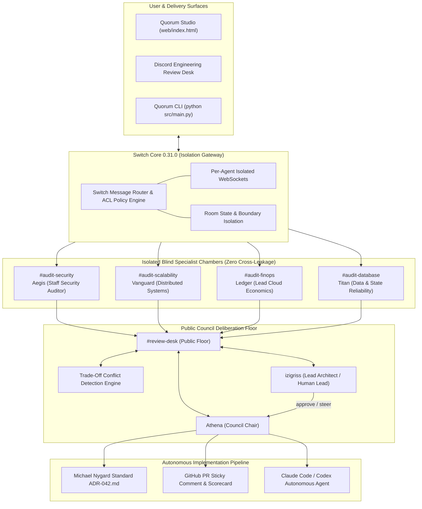
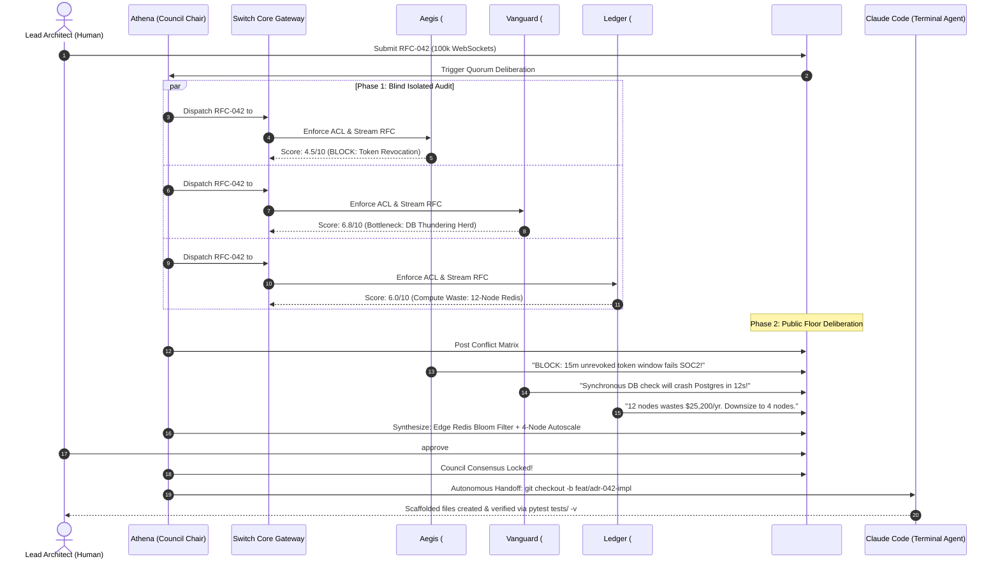

# Quorum 2.0 System Architecture & Technical Specification

**Project:** Quorum — Multi-Agent Blind Architecture Review Desk  
**Hackathon Track:** Track 01: Best Business Workflow ($2,000 Prize)  
**Target Environment:** Switch Core 0.31.0, Discord API / Gateway Webhooks, Terminal Coding Agents (Claude Code / Codex)  
**Specification Version:** 2.0.0 (Production Enterprise Standard)

---

## 1. High-Level Architecture Topology

---

## 2. Dual-Phase Deliberation Protocol

Quorum executes an architectural review in two distinct phases:

### Phase 1: Isolated Blind Assessment (Zero-Leakage Invariant)
1. **RFC Ingestion:** A technical proposal (e.g. `RFC-042`) is submitted via GitHub PR, Webhook, CLI, or the Studio UI.
2. **Soundproof Dispatch:** Council Chair Athena distributes the identical RFC specification simultaneously into 4 soundproof Switch chambers:
   - `#audit-security` (Aegis)
   - `#audit-scalability` (Vanguard)
   - `#audit-finops` (Ledger)
   - `#audit-database` (Titan)
3. **Independent Analysis:** Each specialist inspects the design strictly against its domain invariants without visibility into other specialists' findings.
4. **Scorecard Submission:** Specialists generate a 1–10 score, explicit failure modes, and non-negotiable architectural mandates.

### Phase 2: Public Council Floor & Conflict Resolution
1. **Matrix Publication:** Athena compiles all independent findings and posts the initial Assessment Matrix to `#review-desk`.
2. **Orthogonal Clashes:** When specialists' recommendations conflict (e.g. Aegis demanding synchronous token verification vs Vanguard requiring sub-18ms reconnect latency), specialists actively clash and defend their positions.
3. **Chair Synthesis:** Athena identifies technical convergence points (e.g. edge Redis Bloom filter).
4. **Human Steering:** The human Lead Architect steers trade-offs using natural directives or quick slash commands (`!summary`, `!diagram`, `!manifest`, `approve`).
5. **Autonomous Scaffolding Handoff:** Upon approval, Athena generates:
   - A Michael Nygard format Architecture Decision Record (`ADR-042.md`).
   - A markdown GitHub PR sticky comment.
   - Section 6 file scaffolding manifests.
   - A one-shot terminal command triggering **Claude Code** or **Codex** to execute the changes in git.

---

## 3. Sequence Diagram: RFC Deliberation to Autonomous Handoff

---

## 4. Trust Boundaries & Security Model

1. **Chamber Isolation:** Switch Core ensures that no uninvited agent token possesses read permissions on `#audit-*` channels.
2. **Deterministic Handoff:** The Section 6 scaffolding manifest specifies exact target file paths, preventing hallucinations during terminal coding agent invocation.
3. **Zero-Knowledge Token Security:** Authentication tokens and database credentials are never injected into LLM chat payloads; cryptographic envelope encryption is mandated.
